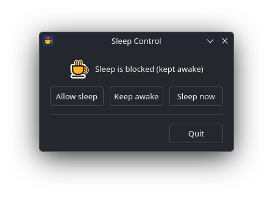

# Sleep Control

[](https://github.com/Ghost-Hackers/sleep-control/actions/workflows/ci.yml)
[](https://github.com/Ghost-Hackers/sleep-control/actions/workflows/codeql.yml)
[](https://microsoft.github.io/pyright/)
[](https://github.com/Ghost-Hackers/sleep-control/releases)
[](pyrightconfig.json)
[](LICENSE)

Sleep Control keeps a Linux PC awake while something long is running, like a download, a backup or a game update. It sits in the system tray and shows whether sleep is blocked. When you allow sleep again, or quit the app, the computer follows your power settings as usual.

I wrote it for my own Steam Deck and used it there before it had a repository. I'm moving it to GitHub now so anyone can use it as they see fit.

It is a PyQt6 app shipped as a Flatpak (`io.github.ghost_hackers.sleep-control`).

The goal for 1.0.0 is a keep-awake tool that works on every major Linux desktop and in Steam Deck Game Mode, with timers, schedules, updates and translations. The [roadmap](#roadmap) lists the steps, and the sections before it describe what the latest release does.

<p align="center"></p>

## Contents

- [Features](#features)
- [Requirements](#requirements)
- [Install](#install)
- [Use](#use)
- [How it works](#how-it-works)
- [Troubleshooting](#troubleshooting)
- [Uninstall](#uninstall)
- [Building from source](#building-from-source)
- [Roadmap](#roadmap)
- [Security](#security)
- [License](#license)

## Features

- A tray icon that shows whether sleep is blocked, with a menu for Keep awake, Allow sleep and Sleep now.
- A window with the same buttons, for desktops that have no tray.
- Terminal commands (`on`, `off`, `now`, `status`), so a script can hold the PC awake for the length of a job.
- One copy per session. Launching the app again opens the window of the running one.
- No leftovers: the block ends when you allow sleep, quit the app or the app crashes.

## Requirements

A Linux desktop with Flatpak and the Flathub remote set up. Sleep Control is tested on KDE Plasma in Steam Deck desktop mode so far. Other desktops, Game Mode included, are planned and tracked in the [milestones](https://github.com/Ghost-Hackers/sleep-control/milestones).

## Install

Download `sleep-control-<version>.flatpak` from the [latest release](https://github.com/Ghost-Hackers/sleep-control/releases). Double-clicking it opens Discover or GNOME Software. From a terminal:

```sh
flatpak install --user sleep-control-<version>.flatpak
```

The KDE runtime the app needs is pulled from Flathub automatically, so Flathub has to be set up as a remote. Then start Sleep Control from your app launcher.

## Use

The tray icon changes when sleep is blocked. Its menu shows the current state and has Allow sleep, Keep awake, Sleep now, Show window and Quit.

Starting the app from the launcher opens a window with the same buttons. If the app is already running, launching it again just brings that window up. On a desktop without a tray the window is all you get, and the launcher's right-click menu also offers Keep awake and Allow sleep.

The same actions work from a terminal. They talk to the running app, and `on` starts it in the background when it isn't running yet.

| Command | What it does |
| --- | --- |
| `flatpak run io.github.ghost_hackers.sleep-control on` | Keeps the PC awake |
| `flatpak run io.github.ghost_hackers.sleep-control off` | Allows sleep again |
| `flatpak run io.github.ghost_hackers.sleep-control now` | Suspends the PC right away |
| `flatpak run io.github.ghost_hackers.sleep-control status` | Prints whether sleep is blocked |
| `flatpak run io.github.ghost_hackers.sleep-control --version` | Prints the version |

Exit code 0 means the command worked, 1 means it failed (the reason goes to stderr), and 2 means the arguments were wrong.

## How it works

Keep awake asks the desktop's Inhibit portal to block suspend and idle, and holds that request while the app runs. Quitting the app releases it. If the app is killed or crashes, the portal drops the request along with the connection, so nothing is left behind.

On KDE the portal hands the request to Plasma's power management. It shows up in the inhibitions list in the power settings, not in `systemd-inhibit --list`. Plasma can take a few seconds to apply a new block, but it drops one immediately.

Sleep now is the only thing that suspends the machine, and only when you ask for it. It calls logind directly.

The Flatpak requests these permissions, set in the [manifest](packaging/flatpak/io.github.ghost_hackers.sleep-control.yml):

| Permission | Why |
| --- | --- |
| `--share=ipc` | Qt needs shared memory to draw the window under X11 |
| `--socket=wayland` | Shows the window and tray on Wayland |
| `--socket=fallback-x11` | Does the same on X11 sessions |
| `--talk-name=org.kde.StatusNotifierWatcher` | Registers the tray icon |
| `--system-talk-name=org.freedesktop.login1` | Lets Sleep now suspend through logind |

The KDE runtime the app is built on adds a few permissions of its own: read access to `~/.config/kdeglobals` and the KDE settings and app menu services on the session bus, so Qt follows your theme and fonts. `flatpak info --show-permissions io.github.ghost_hackers.sleep-control` lists everything the installed app has.

The command line talks to the running app over a socket in the app's own runtime directory, readable by your user only. An empty `control.sock.lock` next to it marks which copy is running and stays after the app quits. The runtime directory is cleared when you log out.

## Troubleshooting

**Keep awake is on, but the block isn't in `systemd-inhibit --list` (KDE).** Plasma takes the request from the portal and keeps it itself. Look in the inhibitions list in the power settings instead.

**There is no tray icon (GNOME).** GNOME doesn't show tray icons without an AppIndicator extension. Open the window from the app launcher and use its buttons, or use the terminal commands.

**`on` prints "didn't start".** The command starts the app in the background when it isn't running, and the app didn't answer within 15 seconds. Start Sleep Control from the launcher to see whether the window opens. `status` and `off` don't start anything: with no app running they report that sleep is allowed.

**The lid or the power button still suspends the PC.** Keep awake blocks idle sleep and suspend requests from other programs. Closing the lid ignores sleep blocks by default (logind's `LidSwitchIgnoreInhibited=yes`), and on KDE and GNOME the desktop's power settings decide what the power button does. Sleep Control doesn't change either.

## Uninstall

```sh
flatpak uninstall --user --delete-data io.github.ghost_hackers.sleep-control
```

Without `--delete-data` the app's data folder under `~/.var/app` stays.

## Building from source

`tools/build.sh` builds the Flatpak into `dist/` and needs Flatpak Builder, the KDE SDK and the PyQt6 BaseApp. [CONTRIBUTING.md](CONTRIBUTING.md) has the setup, the tests and the repository layout. Release bundles are built by GitHub Actions from the tag, and each one is attested.

## Roadmap

1.0.0 is the first stable release and the one that goes on Flathub. Each version on the way adds one group of features:

| Version | What it adds |
| --- | --- |
| [0.1.0](https://github.com/Ghost-Hackers/sleep-control/milestone/1) | The app itself: Keep awake, Allow sleep and Sleep now from the tray, the window and a terminal, a single instance, and releases built by GitHub Actions |
| [0.2.0](https://github.com/Ghost-Hackers/sleep-control/milestone/2) | Timers and conditions: keep awake for a set time or until a clock time, or only while on AC power or while the network is busy |
| [0.3.0](https://github.com/Ghost-Hackers/sleep-control/milestone/3) | Settings and startup: start at login, restore the last state, choose what is blocked, a global shortcut and optional notifications |
| [0.4.0](https://github.com/Ghost-Hackers/sleep-control/milestone/4) | Dark and light mode: follow the desktop's preference and accent color, or pick System, Light or Dark |
| [0.5.0](https://github.com/Ghost-Hackers/sleep-control/milestone/5) | Updates: update checks and notifications, with Update now or automatic updates |
| [0.6.0](https://github.com/Ghost-Hackers/sleep-control/milestone/6) | Schedules: keep awake on chosen days between two times, with skip once |
| [0.7.0](https://github.com/Ghost-Hackers/sleep-control/milestone/7) | Steam Deck Game Mode: a controller-friendly window, a Steam library entry and a block that stays while a game runs |
| [0.8.0](https://github.com/Ghost-Hackers/sleep-control/milestone/8) | Desktops: KDE, GNOME, Cinnamon, XFCE, MATE, Budgie, LXQt, COSMIC, Pantheon, Sway and Hyprland, with or without a tray |
| [0.9.0](https://github.com/Ghost-Hackers/sleep-control/milestone/9) | Languages and access: 13 languages, keyboard and screen reader use, and high-contrast icons |
| [1.0.0](https://github.com/Ghost-Hackers/sleep-control/milestone/10) | Stable: a frozen command line and settings format, a security review, the full test matrix and the Flathub listing |

Each version links to its milestone, which shows what is done and what is open.

## Security

Report problems privately, as described in [SECURITY.md](SECURITY.md). That file also shows how to verify a download.

## License

Free to use and to share unchanged; changes need written permission. The full terms are in [LICENSE](LICENSE).

[](#sleep-control)
